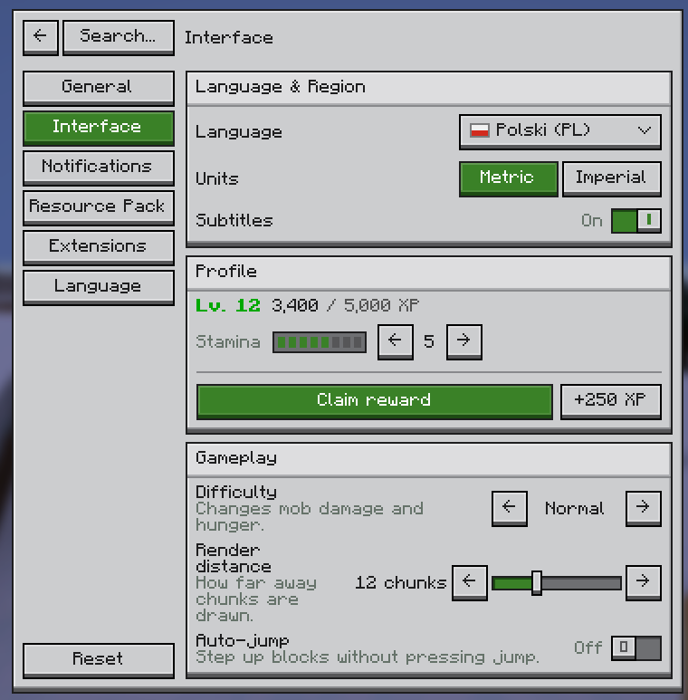

# Canvas

Stateful, layout-driven UIs inside Minecraft Java dialogs (Paper 26.3). No client mods: every screen is drawn with
glyphs from a resource pack Canvas generates.

<p align="center">
  
</p>

```java
public class SettingsScreen implements NodeLike {

    public static void open(final Player player) {
        new Canvas(new SettingsScreen()).open(player);
    }

    @Override
    public Node getNode(final Scope scope) {
        final State<Boolean> moving = scope.useState(false);
        return Panel.builder()
            .title("Visuals")
            .add(SettingRow.builder().label("Moving background").control(Toggle.of(moving)).build())
            .build();
    }
}
```

## Install

Canvas is published through [JitPack](https://jitpack.io/#Chubbyduck1/Canvas). Use a release tag (or a commit hash)
as the version:

[](https://jitpack.io/#Chubbyduck1/Canvas)

```kotlin
repositories {
    maven("https://jitpack.io")
}

dependencies {
    compileOnly("com.github.Chubbyduck1.Canvas:canvas-paper:<tag>")
}
```

**As a plugin:** download `Canvas.jar` from [Releases](https://github.com/Chubbyduck1/Canvas/releases) into
`plugins/`, add `depend: [Canvas]` to your `plugin.yml`, keep the dependency `compileOnly`, and register your own
nodes in `onEnable`:

```java
public class MyPlugin extends JavaPlugin {

    @Override
    public void onEnable() {
        CanvasRuntime.get().register(MyNode.class);
    }
}
```

**Shaded:** depend on it with `implementation` and shade it with [Shadow](https://gradleup.com/shadow/). Relocate
Canvas and leave out what Paper already provides:

```kotlin
dependencies {
    implementation("com.github.Chubbyduck1.Canvas:canvas-paper:<tag>")
}

tasks.shadowJar {
    relocate("me.chubbyduck.canvas", "com.example.myplugin.libs.canvas")
    dependencies {
        exclude(dependency("net.kyori:.*"))
        exclude(dependency("com.google.code.gson:.*"))
        exclude(dependency("org.jetbrains:annotations"))
        exclude(dependency("org.jspecify:jspecify"))
    }
}
```

Then start it yourself in `onEnable` (don't also install the Canvas plugin):

```java
public class MyPlugin extends JavaPlugin {

    @Override
    public void onEnable() {
        CanvasRuntime.bootstrap(this).register(Nodes.defaults()).register(MyNode.class).start();
    }
}
```

Canvas writes its resource pack to `plugins/<plugin>/pack.zip` and logs its SHA-1. Host it (or merge it into your
server pack) and send it to players.

`plugins/Canvas/config.yml`:

| Option         | Default | Effect                                                                                     |
|----------------|---------|-------------------------------------------------------------------------------------------|
| `require-pack` | `false` | `true`: plain dialogs until a resource pack has loaded (`.requirePack(true)` when shaded) |
| `metrics`      | `true`  | Anonymous usage statistics on [bStats](https://bstats.org)                                |

## Build

`./gradlew build` builds every module and `canvas-paper/build/libs/Canvas-<version>.jar`.
`./gradlew runServer` starts a test server with the example plugin (`/ks`).

## Notice

Canvas is not affiliated with or endorsed by Mojang Studios or Microsoft. Minecraft is a trademark of Mojang
Studios. The generated pack reuses the vanilla font by reference (no Mojang assets are shipped) and includes an
optional `core/gui` shader derived from vanilla's, which hides the dialog focus outline.

The project was partially generated with Claude Opus 5.5. My reasoning was as follows: Just wanted to make it work, can make it pretty later :)

## License

[MIT](LICENSE)
